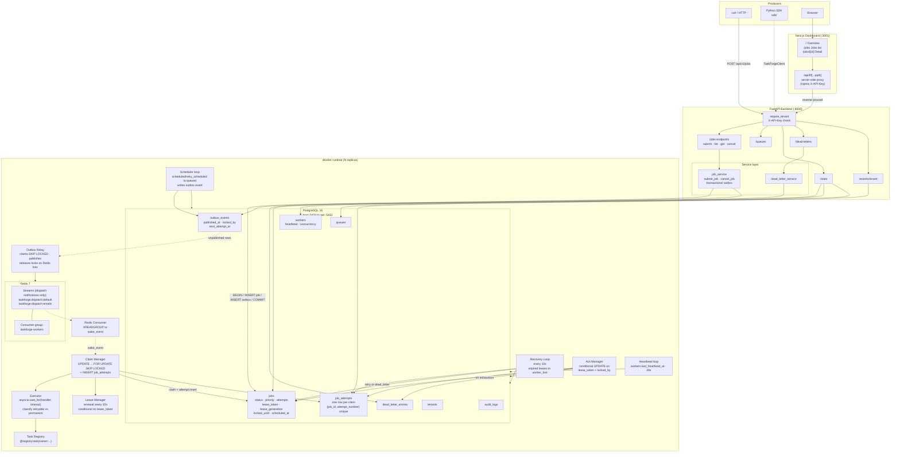
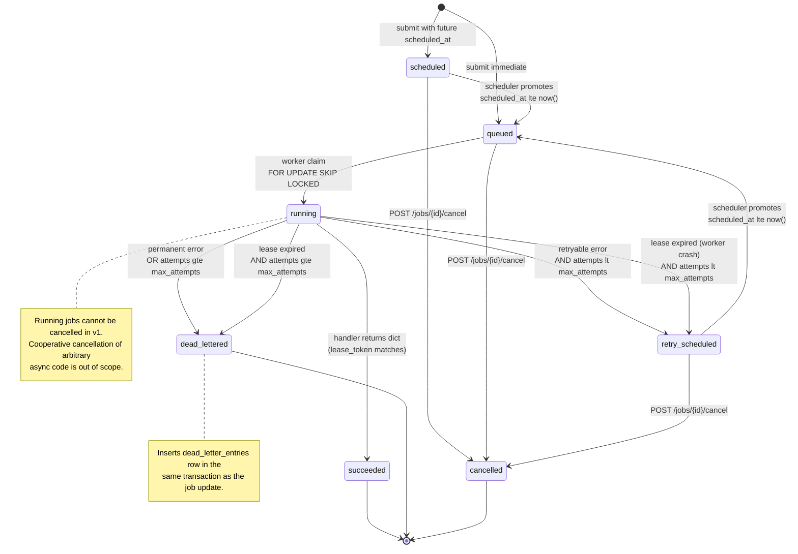
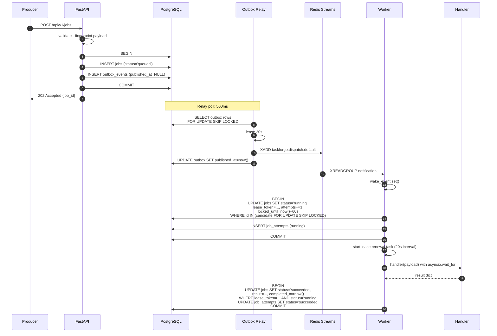
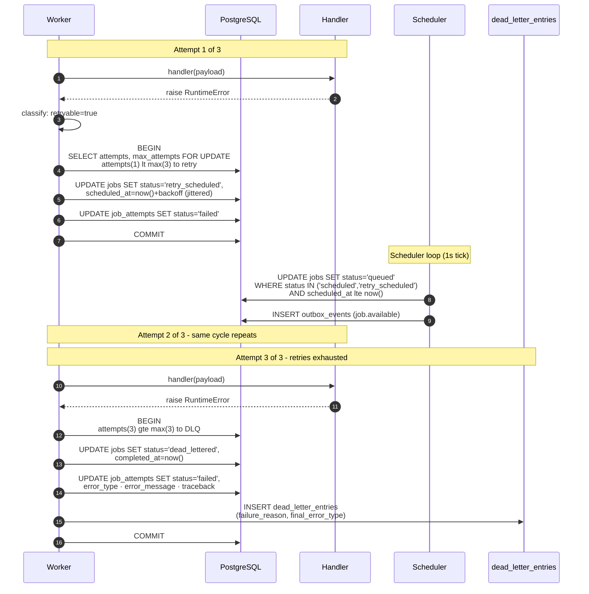
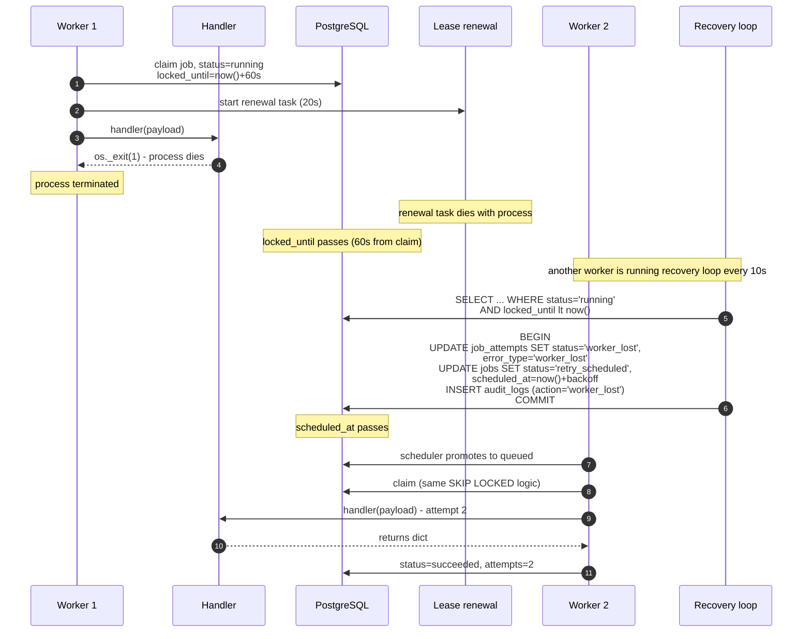

# TaskForge

Distributed background-job processing engine. **PostgreSQL is the authoritative source of job state. Redis Streams is a dispatch transport, not a job database.**

Built against the technical specification in `docs/architecture.md` (source of truth).

> **Diagram rendering:** GitHub and GitLab render Mermaid natively. For local viewing install the *Markdown Preview Mermaid Support* extension in VS Code, or open in any Mermaid-capable renderer.

---

## Status

**MVP complete as of 12 November 2026.** Every invariant INV-01 through INV-12 is protected by code and verified.

End-to-end flow works and is demonstrable: submit → persist → dispatch → claim → execute → retry → dead-letter → recover-after-Redis-outage → recover-after-worker-crash, plus a Next.js operational dashboard and a typed Python SDK.

| Block | Scope | Status |
|---|---|---|
| 1 | Foundation (Postgres 16, Redis 7, Compose stack) | ✅ |
| 2 | Schema (8 tables, CHECK constraints, partial indexes, dev seed) | ✅ |
| 3a | Submission API (auth, idempotency, transactional outbox) | ✅ |
| 3b | Worker (atomic claim, attempt history, graceful drain) | ✅ |
| 3c | Retries / DLQ (classification, backoff, dead-letter entries) | ✅ |
| 3d | Dispatch (outbox relay + Redis Streams + polling fallback) | ✅ |
| 4 | Dashboard (Overview / Jobs / Detail) + backend tests + this README | ✅ |
| 5 | Lease reaper + lease renewal + worker crash recovery (INV-09) | ✅ |
| 6 | Python SDK (`sdk/`) — typed async client + task registry | ✅ |

Tagged releases: `v0.1.0-mvp`, `v0.1.1-redesign`, `v0.1.2-resilient`, `v0.1.3-sdk`.

---

## Quickstart

Prereqs: Docker + Compose, and Node.js 20+ on the host (only for the dashboard's `npm install`).

```bash
# 1. Environment
cp .env.example .env

# 2. Install dashboard dependencies once (host is faster than Docker)
cd dashboard && npm install --no-audit --no-fund && cd ..

# 3. Start the full stack
docker compose up -d --build
sleep 5 && docker compose ps

# 4. Run migrations (creates schema + seeds dev tenant and default queues)
docker compose exec backend alembic upgrade head
```

You should see 5 services `Up`: `postgres`, `redis`, `backend`, `worker`, `dashboard`.

First dashboard hit triggers a Next.js dev compile (~8s); subsequent hits are <300ms.

| URL | Purpose |
|---|---|
| http://localhost:3001 | Dashboard (Overview / Jobs / Job Detail) |
| http://localhost:8000/docs | FastAPI interactive API docs |
| http://localhost:8000/api/v1/health/ready | Readiness probe |
| http://localhost:8000/api/v1/stats | Overview stats JSON (dashboard consumes via proxy) |

---

## Python SDK

A typed async client for the HTTP API lives in [`sdk/`](./sdk/README.md).

```bash
cd sdk && pip install -e ".[dev]"
```

```python
from taskforge import TaskForgeClient

async with TaskForgeClient(api_key="dev-api-key-change-me") as client:
    job = await client.enqueue(
        task_name="send_welcome_email",
        queue="emails",
        payload={"recipient": "user@example.com"},
    )
    final = await client.wait_for(job.id)
    print(final.status)  # "succeeded"
```

Full SDK docs: [`sdk/README.md`](./sdk/README.md). 20 tests via `pytest`.

---

## Demo path

Runs in ~60 seconds against the live stack. Each command proves one guarantee.

### 1. Submit a job

```bash
curl -s -X POST http://localhost:8000/api/v1/jobs \
  -H "Content-Type: application/json" \
  -H "X-API-Key: dev-api-key-change-me" \
  -d '{"queue":"default","task_name":"echo","payload":{"hello":"world"}}' \
  | python3 -m json.tool
```

Returns `202 Accepted` with `job_id` and `status: "queued"`. Job **and** outbox event persisted in one transaction.

### 2. Watch it succeed

Open http://localhost:3001 — Total jobs +1, job appears in `/jobs` as `succeeded` within ~3s. Or:

```bash
docker compose exec postgres psql -U taskforge -d taskforge \
  -c "SELECT status, attempts, result FROM jobs ORDER BY created_at DESC LIMIT 1;"
```

### 3. Controlled failure → retry → dead-letter

```bash
curl -s -X POST http://localhost:8000/api/v1/jobs \
  -H "Content-Type: application/json" \
  -H "X-API-Key: dev-api-key-change-me" \
  -d '{
    "queue":"default",
    "task_name":"always_fail",
    "payload":{"reason":"demo"},
    "retry_policy":{
      "max_attempts":3,
      "initial_delay_seconds":1,
      "max_delay_seconds":3,
      "jitter":true
    }
  }'
```

Watch its `status` progress through `queued → running → retry_scheduled → running → retry_scheduled → running → dead_lettered` (~4s total). Each attempt is recorded in `job_attempts`. One row appears in `dead_letter_entries`.

```bash
curl -s http://localhost:8000/api/v1/dead-letters \
  -H "X-API-Key: dev-api-key-change-me" | python3 -m json.tool
```

### 4. Redis outage — jobs still process

```bash
# Stop Redis
docker compose stop redis

# Submit and verify it still succeeds via PostgreSQL polling fallback
curl -s -X POST http://localhost:8000/api/v1/jobs \
  -H "Content-Type: application/json" -H "X-API-Key: dev-api-key-change-me" \
  -d '{"queue":"default","task_name":"echo","payload":{"redis":"down"}}'

# Outbox backlog builds up
docker compose exec postgres psql -U taskforge -d taskforge \
  -c "SELECT COUNT(*) FROM outbox_events WHERE published_at IS NULL;"

# Bring Redis back
docker compose start redis

# Backlog drains within ~5s (relay reconnect window)
sleep 6
docker compose exec postgres psql -U taskforge -d taskforge \
  -c "SELECT COUNT(*) FROM outbox_events WHERE published_at IS NULL;"
```

**Committed jobs are never lost.** The relay releases outbox locks on connection loss, then retries after reconnect.

### 5. Worker crash recovery

```bash
# Submit a job that hard-kills the worker mid-execution
curl -s -X POST http://localhost:8000/api/v1/jobs \
  -H "Content-Type: application/json" -H "X-API-Key: dev-api-key-change-me" \
  -d '{"queue":"default","task_name":"crash_self","payload":{"seconds":1},"retry_policy":{"max_attempts":2,"initial_delay_seconds":2,"jitter":false}}'

# Watch worker logs — crash, restart, reaper fires on the expired lease
docker compose logs -f worker | grep -E "recovered expired lease|worker lost|succeeded"
```

**What happens:** worker calls `os._exit(1)` mid-handler → Docker `restart: on-failure:5` restarts it within ~2s → 60s later the lease expires → reaper marks attempt `worker_lost` → job goes to `retry_scheduled` → new worker attempt succeeds. All observability in `audit_logs` (`action='worker_lost'`) and `job_attempts` (`status='worker_lost'`).

### 6. Multi-worker concurrency (INV-03)

```bash
docker compose up -d --scale worker=3

# Submit 100 jobs in parallel
for i in $(seq 1 100); do
  curl -s -X POST http://localhost:8000/api/v1/jobs \
    -H "Content-Type: application/json" -H "X-API-Key: dev-api-key-change-me" \
    -d "{\"queue\":\"default\",\"task_name\":\"echo\",\"payload\":{\"i\":$i}}" &
done
wait
sleep 3

# Every job has attempts=1; no duplicate (job_id, attempt_number) pairs
docker compose exec postgres psql -U taskforge -d taskforge -c \
  "SELECT status, COUNT(*) FROM jobs WHERE created_at > now() - interval '2 minutes' GROUP BY 1;"

docker compose up -d --scale worker=1
```

---

## Architecture

### System view



### Job lifecycle (state machine)



### Happy path: submit → dispatch → execute → ack



### Failure path: retry → exhaustion → dead-letter



### Worker crash recovery (INV-09)



### Invariants protected by code

| Invariant | Where enforced |
|---|---|
| INV-01 Job accepted only after commit | `services/job_service.py` (transactional outbox) |
| INV-02 Postgres authoritative | Every worker claim/ack goes through Postgres |
| INV-03 No two valid leases | `workers/claim_manager.py` uses `FOR UPDATE SKIP LOCKED` |
| INV-04 Only current lease token acks | `workers/ack_manager.py` conditional UPDATE on `lease_token + locked_by` |
| INV-05 Every attempt recorded | `workers/claim_manager.py` inserts `job_attempts` in claim transaction |
| INV-06 Attempt + state change transactional | `record_success/failure` and `recovery._recover_one` in one commit each |
| INV-07 Terminal jobs not claimable | Claim SQL filters `status='queued'` |
| INV-08 Duplicate dispatch no dup ownership | Postgres `status='queued'` predicate |
| INV-09 Expired leases recovered | `workers/recovery.py` reaper + `workers/lease_manager.py` renewal |
| INV-10 Redis outage does not destroy committed jobs | `broker/relay.py` releases locks on connection loss |
| INV-11 Idempotency dedupes | Partial unique index `(tenant_id, idempotency_key)` + fingerprint check |
| INV-12 Every query tenant-scoped | `core/security.py::require_tenant` + every repository `WHERE` |

---

## Testing

### Automated tests

```bash
# Backend: 31 tests
docker compose exec backend pytest -q

# SDK: 20 tests (independent venv, no live backend needed)
cd sdk && pip install -e ".[dev]" && pytest -q
```

**Backend** (`backend/tests/unit/`) — 4 files:
- `test_retry_policy.py` — backoff computation, jitter bounds, cap, defaults
- `test_idempotency.py` — fingerprint determinism, dict-order invariance, uniqueness
- `test_error_classification.py` — retryable vs permanent via real executor
- `test_payload_validation.py` — task-name regex, priority, timeout, retry policy bounds

**SDK** (`sdk/tests/`) — 2 files:
- `test_client.py` — 16 tests via `httpx.MockTransport` (no live backend): enqueue body, retry policy, idempotency, pagination, multi-status params, error mapping, connection errors, `wait_for`
- `test_registry.py` — 4 tests: bare decorator, named decorator, empty parens, duplicate detection

### Manual verification scripts

During development, integration / concurrency / failure-injection were verified via shell scripts (`verify_retry.sh`, `verify_concurrency.sh`, `verify_dispatch.sh`, `verify_reaper.sh`). These are the source of truth for "it works end-to-end" claims in this README. Converting them to committed pytest fixtures is the top item in Planned Features.

---

## Configuration

All configuration via environment variables. See `.env.example` for the full list.

| Variable | Default | Purpose |
|---|---|---|
| `API_KEY` | `dev-api-key-change-me` | API auth. **Change in production.** |
| `TENANT_ID` | `00000000-...-0001` | Seeded dev tenant (must match DB) |
| `DATABASE_URL` | `postgresql+asyncpg://...` | Async DB URL |
| `REDIS_URL` | `redis://localhost:6381/0` | Redis URL |
| `WORKER_CONCURRENCY` | `10` | Max in-flight jobs per worker |
| `LEASE_DURATION_SECONDS` | `60` | Job lease TTL |
| `HEARTBEAT_INTERVAL_SECONDS` | `20` | Worker heartbeat + lease renewal interval |
| `RECOVERY_SCAN_INTERVAL_SECONDS` | `10` | Lease reaper scan interval |

**Ports are remapped to avoid conflicts** with other local projects: Postgres host `5434`, Redis host `6381`, backend `8000`, dashboard `3001`. Inside the Docker network, services use standard ports (`postgres:5432`, `redis:6379`, `backend:8000`).

---

## Implemented features (v1 MVP)

**Submission and API**
- ✅ Durable job submission with transactional outbox (INV-01, INV-11)
- ✅ Idempotency keys — dedupe on same payload, 409 on mismatch
- ✅ Cursor pagination, status/queue/task filters
- ✅ Request-ID middleware, consistent error envelope
- ✅ Tenant scoping on every query (INV-12)
- ✅ `POST /jobs/{id}/cancel` for queued/scheduled/retry_scheduled jobs
- ✅ `/stats` overview endpoint (with status_vein + throughput_60s)
- ✅ `/events/recent` for live-activity feeds
- ✅ `/dead-letters` inspection endpoints

**Worker and execution**
- ✅ Atomic claim via `FOR UPDATE SKIP LOCKED` (INV-03 verified under 3-worker load)
- ✅ Explicit task registry with `@registry.task(name=...)`
- ✅ Bounded-concurrency async worker (`WORKER_CONCURRENCY`)
- ✅ Per-job timeout (`asyncio.wait_for`)
- ✅ Full attempt history — one row per claim (INV-05)
- ✅ Conditional ack — only current lease token can write (INV-04)
- ✅ Error classification (retryable vs permanent)
- ✅ Exponential backoff + full jitter (unit-tested)
- ✅ Retry scheduling → `retry_scheduled` → scheduler promotes to `queued`
- ✅ Dead-letter on exhaustion with `dead_letter_entries` row
- ✅ Worker heartbeats (20s)
- ✅ **Lease renewal** — periodic `locked_until` extension while handler runs
- ✅ **Lease reaper** — recovers jobs with expired leases (marks attempt `worker_lost`, retries or DLs, writes `audit_logs`)
- ✅ **Worker crash recovery** — verified end-to-end via `crash_self` handler
- ✅ Docker `restart: on-failure:5` on worker service
- ✅ Graceful worker shutdown (`stop_grace_period: 60s`)

**Dispatch and reliability**
- ✅ Outbox relay (SKIP LOCKED, batch publish, lock release on Redis loss — INV-10)
- ✅ Redis Streams dispatch (notifications only, no payloads)
- ✅ Consumer with XREADGROUP + immediate ack
- ✅ PostgreSQL polling fallback (verified: jobs process with Redis down)

**Dashboard**
- ✅ Overview page: live throughput sparkline, status vein, asymmetric stat cards, queues, recent failures, live events rail
- ✅ Jobs list: dark monospace table, status filter chips, queue/task-name filters, cursor pagination
- ✅ Job detail: attempt timeline with per-attempt error + expandable traceback, cancel button
- ✅ Server-side API proxy (API key never reaches the browser)
- ✅ Live polling (3s overview / 2s detail)

**SDK**
- ✅ `TaskForgeClient` — async client with enqueue, get, list, iter, cancel, wait_for, queues, health
- ✅ `TaskRegistry` — framework-agnostic handler registration with three decorator forms
- ✅ Typed error hierarchy mapping HTTP statuses
- ✅ Installable via `pip install -e ./sdk`
- ✅ Runnable quickstart against live backend

---

## Planned features

| # | Item | Notes |
|---|---|---|
| 1 | **Automated pytest versions of integration/concurrency/failure tests** | Currently shell scripts run during development. Committing them as pytest fixtures gives `pytest -q` full coverage of the invariants. |
| 2 | **Manual retry from `failed` state** | `POST /jobs/{id}/retry`. Currently `failed` is defined but no API action produces it. |
| 3 | **Dead-letter replay** | `POST /dead-letters/{id}/replay` (spec §11.2). Row + inspection exist; replay action doesn't. |
| 4 | **Dead-letter dashboard page** | API exists. UI page not built. |
| 5 | **Prometheus `/metrics` + Grafana** | Spec §15 metric list. |
| 6 | **Weighted fair scheduling** | Spec §10. Currently strict priority (high floods can starve low). |
| 7 | **SSE live updates in dashboard** | Replaces 2-3s polling. |
| 8 | **k6 benchmark report** | Spec §15. |
| 9 | **Rate limiting** | Spec §14. |
| 10 | **Queue-level `max_concurrency` enforcement** | Column exists, worker doesn't honor per-queue caps. |
| 11 | **Multi-tenant isolation tests** | Single tenant seeded; enforcement untested adversarially. |
| 12 | **Worker heartbeat staleness monitoring** | Not surfaced as a metric or alert. |
| 13 | **`XAUTOCLAIM` for pending dispatch messages** | Spec §3.3 explicitly deferred. |
| 14 | **SDK: batch enqueue** | Submit N jobs in one HTTP call. |
| 15 | **SDK: sync client** | Currently async-only. |

---

## Known limitations

Documented honestly per spec §0 and §20.

1. **Strict priority, not weighted fairness.** Spec §10 target is weighted fair scheduling (high:6 / normal:3 / low:1). MVP uses strict priority ordering — a high-priority flood starves low-priority work.

2. **`failed` status is defined but never written.** All failure paths route to `retry_scheduled` or `dead_lettered`. `POST /jobs/{id}/retry` (which would target `failed → queued`) is planned.

3. **`XAUTOCLAIM` not implemented.** Consumer acks immediately after waking claim loop; if wake is lost, PostgreSQL polling picks up the job within 1s.

4. **Integration/concurrency/failure tests are shell scripts, not pytest.** All categories in §17 were manually verified during development. Automated versions are top of the Planned list.

5. **Dead-letter replay endpoint not wired.** `dead_letter_entries` rows exist and are queryable via `/api/v1/dead-letters`. The `POST .../replay` action is planned.

6. **Dashboard is polling, not SSE.** 2-3s interval. Spec §13 explicitly allows this for MVP.

7. **`next@14.2.18` CVE (2025-12-11).** npm warns on this version. Post-deadline upgrade pending. No new attack surface for the local MVP scope; upgrade to patched `14.2.x` or `15.x` before any deployment.

8. **Local Python is 3.14; backend container uses 3.12-slim.** All backend Python runs inside the container. SDK runs on host Python 3.10+ (no compiled deps).

9. **`metadata` column renamed to `extra_data`** in `audit_logs`. SQLAlchemy reserves `metadata` on declarative models. Same semantics.

10. **Task handlers are I/O-bound only.** CPU-bound handlers block the event loop (documented per spec §8). Process-pool extension deferred.

11. **`pytest_asyncio` deprecation warning** on test runs. Harmless. One-line fix pending in `pyproject.toml`.

12. **SDK is async-only.** No sync client wrapper. Also missing: batch enqueue, client-side retries, CLI, PyPI publication. See [`sdk/README.md`](./sdk/README.md#whats-not-here-yet).

---

## Repository layout

```
taskforge/
├── backend/                    FastAPI + worker + engine
│   ├── app/
│   │   ├── api/v1/             health · jobs · queues · dead-letters · stats · events
│   │   ├── core/               config · errors · security
│   │   ├── db/                 session · base
│   │   ├── domain/
│   │   │   ├── enums.py        JobStatus · Priority · WorkerStatus · ...
│   │   │   └── policies/       retry (backoff+jitter) · idempotency (fingerprint)
│   │   ├── broker/             publisher · relay (outbox) · consumer (streams)
│   │   ├── workers/            runtime · claim_manager · lease_manager · recovery ·
│   │   │                       executor · ack_manager · handlers · registry
│   │   ├── models/             8 SQLAlchemy models
│   │   ├── repositories/       job · queue · outbox
│   │   ├── schemas/            Pydantic request/response
│   │   └── services/           job_service · dead_letter_service
│   ├── migrations/             Alembic (hand-written initial)
│   └── tests/unit/             31 pytest tests
├── dashboard/                  Next.js 14 (App Router) + Tailwind
│   ├── app/                    / · /jobs · /jobs/[id]
│   │   └── api/tf/[...path]/   server-side API-key proxy
│   ├── components/             Nav · Card · LiveDot · Sparkline · StatusVein ·
│   │                           CountTick · StatusBadge · AttemptTimeline
│   └── lib/                    api client · polling hook · types
├── sdk/                        Python SDK (pip install -e ./sdk)
│   ├── taskforge/              client · registry · types · exceptions
│   ├── tests/                  20 pytest tests
│   ├── examples/quickstart.py  runs against live backend
│   ├── pyproject.toml
│   └── README.md
├── infrastructure/             (reserved: Prometheus, Grafana)
├── benchmarks/                 (reserved: k6 scripts, reports)
├── docs/                       architecture.md and companions
├── docker-compose.yml
├── .env.example
├── Makefile
└── README.md                   (this file)
```

---

## Makefile shortcuts

```bash
make help              # list all commands
make up                # start postgres + redis only
make up-all            # start full stack
make down              # stop everything (keeps volumes)
make ps                # show service status
make migrate           # run alembic upgrade head
make test              # run backend pytest
make lint              # ruff check
make logs              # tail backend logs
make logs-worker       # tail worker logs
make logs-dashboard    # tail dashboard logs
make shell-db          # psql into taskforge DB
make shell-redis       # redis-cli into taskforge redis
```

---

## Contact / source

**Source:** https://github.com/Olufemooshegs/taskforge

Single-tenant dev instance. All local. See `docs/architecture.md` for the full design spec.