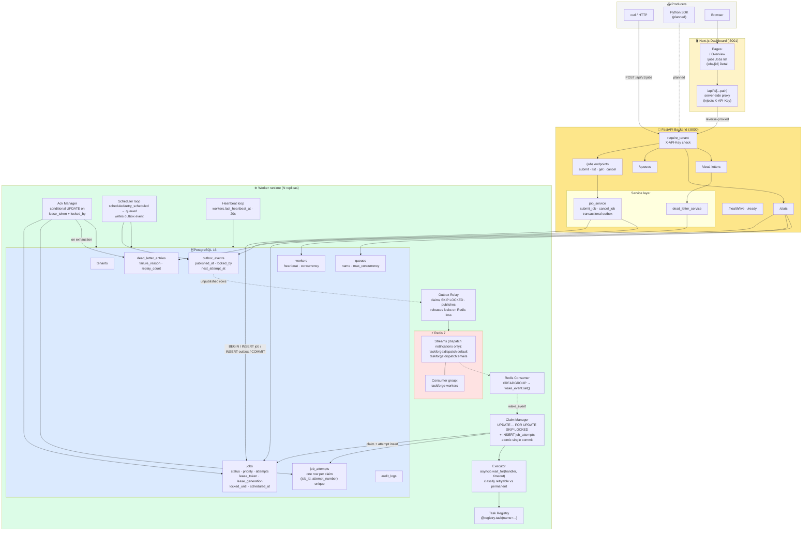
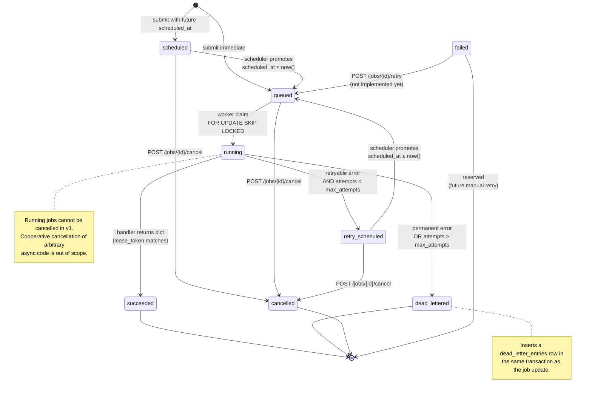
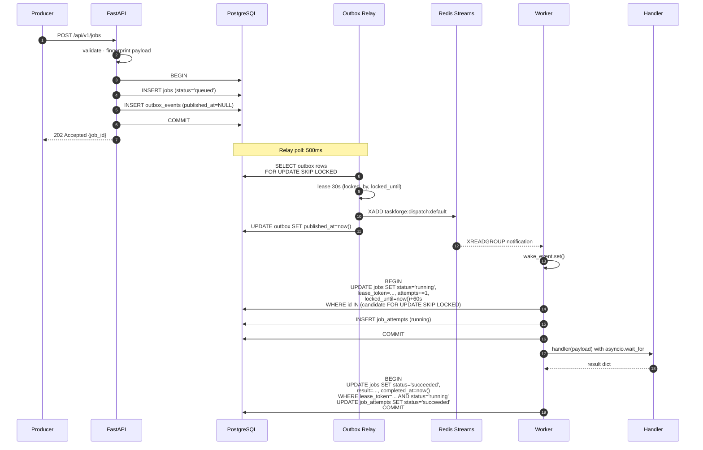
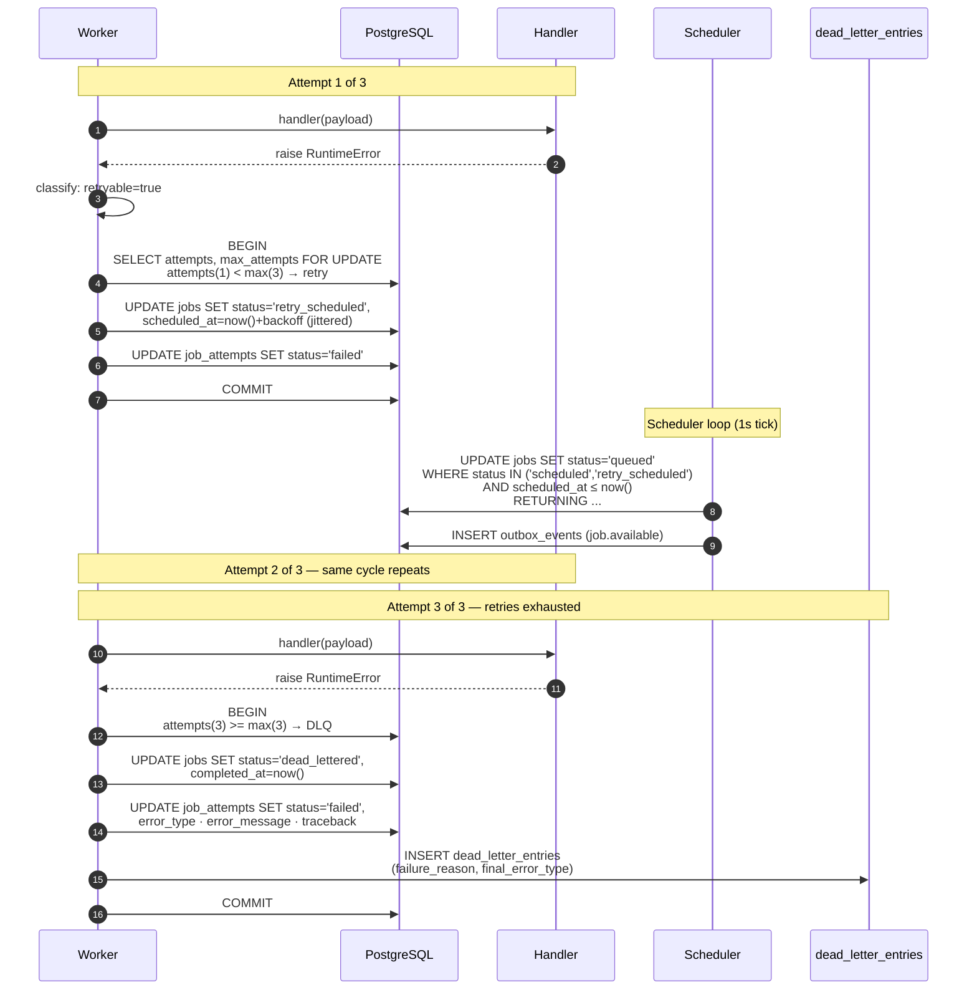
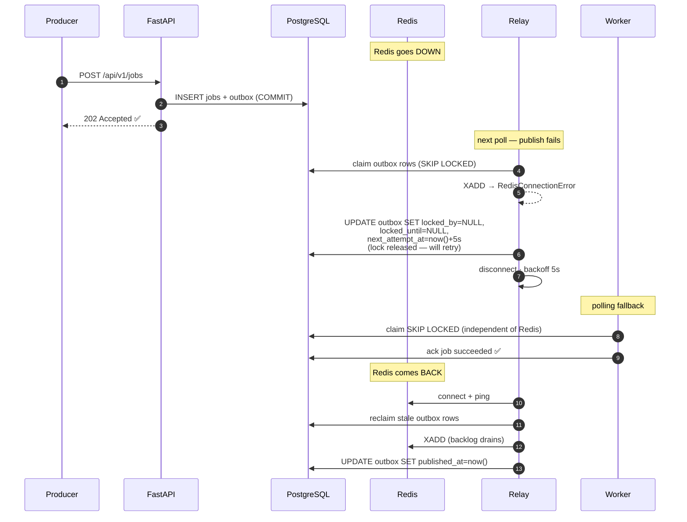

# TaskForge

Distributed background-job processing engine. **PostgreSQL is the authoritative source of job state. Redis Streams is a dispatch transport, not a job database.**

Built against the technical specification in `docs/architecture.md` (source of truth).

## Status

End-to-end flow is working and demonstrable:
submit → persist → dispatch → claim → execute → retry → dead-letter → recover-after-Redis-outage, plus a Next.js operational dashboard.

| Block | Scope | Status |
|---|---|---|
| 1 | Foundation (Postgres 16, Redis 7, Compose stack) | ✅ |
| 2 | Schema (8 tables, CHECK constraints, partial indexes, dev seed) | ✅ |
| 3a | Submission API (auth, idempotency, transactional outbox) | ✅ |
| 3b | Worker (atomic claim, attempt history, graceful drain) | ✅ |
| 3c | Retries / DLQ (classification, backoff, dead-letter entries) | ✅ |
| 3d | Dispatch (outbox relay + Redis Streams + polling fallback) | ✅ |
| 4 | Dashboard (Overview / Jobs / Detail) + unit tests + README | ✅ |
| 5 | Lease reaper + renewal + worker crash recovery (INV-09) | ✅ |

---

## Quickstart

Prereqs: Docker + Compose, and Node.js 20+ on the host (only for the dashboard's `npm install`).

```bash
# 1. Environment
cp .env.example .env

# 2. Install dashboard dependencies once (host is faster than Docker)
cd dashboard && npm install --no-audit --no-fund && cd ..

# 3. Start the full stack
docker compose up -d --build
sleep 5 && docker compose ps

# 4. Run migrations (creates schema + seeds dev tenant and default queues)
docker compose exec backend alembic upgrade head
```

You should see 5 services `Up`: `postgres`, `redis`, `backend`, `worker`, `dashboard`.

First dashboard hit triggers a Next.js dev compile (~8s); subsequent hits are <300ms.

| URL | Purpose |
|---|---|
| http://localhost:3001 | Dashboard (Overview / Jobs / Job Detail) |
| http://localhost:8000/docs | FastAPI interactive API docs |
| http://localhost:8000/api/v1/health/ready | Readiness probe |
| http://localhost:8000/api/v1/stats | Overview stats JSON (dashboard consumes via proxy) |

---

## Architecture

### System view



### Job lifecycle (state machine)



### Happy path: submit → dispatch → execute → ack



### Failure path: retry → exhaustion → dead-letter



### Redis outage and recovery



---

### Invariants protected by code

| Invariant | Where enforced |
|---|---|
| INV-01 Job accepted only after commit | `services/job_service.py` (transactional outbox) |
| INV-02 Postgres authoritative | Every worker claim/ack goes through Postgres |
| INV-03 No two valid leases | `claim_manager.py` uses `FOR UPDATE SKIP LOCKED` |
| INV-04 Only current lease token acks | `ack_manager.py` conditional UPDATE on `lease_token + locked_by` |
| INV-05 Every attempt recorded | `claim_manager.py` inserts `job_attempts` in claim transaction |
| INV-06 Attempt + state change transactional | `record_success/failure` in one commit |
| INV-07 Terminal jobs not claimable | Claim SQL filters `status='queued'` |
| INV-08 Duplicate dispatch no dup ownership | Postgres `status='queued'` predicate |
| INV-09 Expired leases recovered | ✅ `workers/recovery.py` reaper + `workers/lease_manager.py` renewal |
| INV-10 Redis outage does not destroy committed jobs | `broker/relay.py` releases locks on connection loss |
| INV-11 Idempotency dedupes | Partial unique index `(tenant_id, idempotency_key)` + fingerprint check |
| INV-12 Every query tenant-scoped | `core/security.py::require_tenant` + every repository `WHERE` |

---

## Demo path

Runs in ~60 seconds against the live stack. Each command proves one guarantee.

### 1. Submit a job

```bash
curl -s -X POST http://localhost:8000/api/v1/jobs \
  -H "Content-Type: application/json" \
  -H "X-API-Key: dev-api-key-change-me" \
  -d '{"queue":"default","task_name":"echo","payload":{"hello":"world"}}' \
  | python3 -m json.tool
```

Returns `202 Accepted` with `job_id` and `status: "queued"`. Job **and** outbox event persisted in one transaction.

### 2. Watch it succeed

Open http://localhost:3001 — Total jobs +1, job appears in `/jobs` as `succeeded` within ~3s. Or:

```bash
docker compose exec postgres psql -U taskforge -d taskforge \
  -c "SELECT status, attempts, result FROM jobs ORDER BY created_at DESC LIMIT 1;"
```

### 3. Controlled failure → retry → dead-letter

```bash
curl -s -X POST http://localhost:8000/api/v1/jobs \
  -H "Content-Type: application/json" \
  -H "X-API-Key: dev-api-key-change-me" \
  -d '{
    "queue":"default",
    "task_name":"always_fail",
    "payload":{"reason":"demo"},
    "retry_policy":{
      "max_attempts":3,
      "initial_delay_seconds":1,
      "max_delay_seconds":3,
      "jitter":true
    }
  }'
```

Watch its `status` progress through `queued → running → retry_scheduled → running → retry_scheduled → running → dead_lettered` (~4s total). Each attempt is recorded in `job_attempts`. One row appears in `dead_letter_entries`.

```bash
curl -s http://localhost:8000/api/v1/dead-letters \
  -H "X-API-Key: dev-api-key-change-me" | python3 -m json.tool
```

### 4. Redis outage — jobs still process

```bash
# Stop Redis
docker compose stop redis

# Submit and verify it still succeeds via PostgreSQL polling fallback
curl -s -X POST http://localhost:8000/api/v1/jobs \
  -H "Content-Type: application/json" -H "X-API-Key: dev-api-key-change-me" \
  -d '{"queue":"default","task_name":"echo","payload":{"redis":"down"}}'

# Outbox backlog builds up
docker compose exec postgres psql -U taskforge -d taskforge \
  -c "SELECT COUNT(*) FROM outbox_events WHERE published_at IS NULL;"

# Bring Redis back
docker compose start redis

# Backlog drains within ~5s (relay reconnect window)
sleep 6
docker compose exec postgres psql -U taskforge -d taskforge \
  -c "SELECT COUNT(*) FROM outbox_events WHERE published_at IS NULL;"
```

**Committed jobs are never lost.** The relay releases outbox locks on connection loss, then retries after reconnect.

### 5. Multi-worker concurrency (INV-03)

```bash
docker compose up -d --scale worker=3

# Submit 100 jobs in parallel
for i in $(seq 1 100); do
  curl -s -X POST http://localhost:8000/api/v1/jobs \
    -H "Content-Type: application/json" -H "X-API-Key: dev-api-key-change-me" \
    -d "{\"queue\":\"default\",\"task_name\":\"echo\",\"payload\":{\"i\":$i}}" &
done
wait
sleep 3

# Every job has attempts=1; no duplicate (job_id, attempt_number) pairs
docker compose exec postgres psql -U taskforge -d taskforge -c \
  "SELECT status, COUNT(*) FROM jobs WHERE created_at > now() - interval '2 minutes' GROUP BY 1;"

docker compose up -d --scale worker=1
```

---

## Testing

### Automated tests (31 passing)

```bash
docker compose exec backend pytest -q
```

Four unit test files in `backend/tests/unit/`:

| File | Tests | What it proves |
|---|---|---|
| `test_retry_policy.py` | 4 | Backoff determinism, max-delay cap, jitter bounds, defaults, partial override |
| `test_idempotency.py` | 5 | Fingerprint determinism, dict-order invariance, SHA-256 format, uniqueness per payload/queue/task |
| `test_error_classification.py` | 5 | Retryable vs permanent via real executor: generic `Exception` retryable, `PermanentError` not, unknown task not, timeout retryable, success writes result |
| `test_payload_validation.py` | 15 | Task-name regex (5 valid + 6 invalid), priority enum, timeout bounds, retry policy bounds |

### Not automated (verification via scripts)

- **Integration tests** (submit → claim → ack → retry → DLQ) — verified end-to-end via shell scripts during Block 3c
- **Concurrency tests** (3 workers × 100 jobs) — verified via shell script during Block 3b; INV-03 confirmed
- **Failure injection** (kill worker mid-execution, stop Redis) — verified via shell script during Block 3d

Automated pytest versions of these are the top post-MVP item. See Known Limitations.

### Pytest warning

You'll see:

```
PytestDeprecationWarning: The configuration option "asyncio_default_fixture_loop_scope" is unset.
```

Harmless — pytest-asyncio v0.25 deprecation. Fix pending: add `asyncio_default_fixture_loop_scope = "function"` to `[tool.pytest.ini_options]` in `pyproject.toml`.

---

## Configuration

All configuration via environment variables. See `.env.example` for the full list.

| Variable | Default | Purpose |
|---|---|---|
| `API_KEY` | `dev-api-key-change-me` | API auth. **Change in production.** |
| `TENANT_ID` | `00000000-...-0001` | Seeded dev tenant (must match DB) |
| `DATABASE_URL` | `postgresql+asyncpg://...` | Async DB URL |
| `REDIS_URL` | `redis://localhost:6381/0` | Redis URL |
| `WORKER_CONCURRENCY` | `10` | Max in-flight jobs per worker |
| `LEASE_DURATION_SECONDS` | `60` | Job lease TTL |
| `HEARTBEAT_INTERVAL_SECONDS` | `20` | Worker heartbeat frequency |

**Ports are remapped to avoid conflicts** with other local projects: Postgres host `5434`, Redis host `6381`, backend `8000`, dashboard `3001`. Inside the Docker network, services use standard ports (`postgres:5432`, `redis:6379`, `backend:8000`).

---

## Implemented features (v1 MVP)

**Submission & API**
- ✅ Durable job submission with transactional outbox (INV-01, INV-11)
- ✅ Idempotency keys — dedupe on same payload, 409 on mismatch
- ✅ Cursor pagination, status/queue/task filters
- ✅ Request-ID middleware, consistent error envelope
- ✅ Tenant scoping on every query (INV-12)
- ✅ `POST /jobs/{id}/cancel` for queued/scheduled/retry_scheduled jobs
- ✅ `/stats` overview endpoint
- ✅ `/dead-letters` inspection endpoints

**Worker & execution**
- ✅ Atomic claim via `FOR UPDATE SKIP LOCKED` (INV-03 verified under 3-worker load)
- ✅ Explicit task registry with `@registry.task(name=...)`
- ✅ Bounded-concurrency async worker (`WORKER_CONCURRENCY`)
- ✅ Per-job timeout (`asyncio.wait_for`)
- ✅ Full attempt history — one row per claim (INV-05)
- ✅ Conditional ack — only current lease token can write (INV-04)
- ✅ Error classification (retryable vs permanent)
- ✅ Exponential backoff + full jitter (unit-tested)
- ✅ Retry scheduling → `retry_scheduled` → scheduler promotes to `queued`
- ✅ Dead-letter on exhaustion with `dead_letter_entries` row
- ✅ Graceful worker shutdown (`stop_grace_period: 60s`, verified with 30s handler)
- ✅ Worker heartbeats (20s)
- ✅ Lease renewal — periodic `locked_until` extension while handler runs
- ✅ Lease reaper — recovers jobs with expired leases (`worker_lost` attempt + retry or DL)
- ✅ Worker crash recovery (verified end-to-end via `crash_self` handler)
- ✅ Docker `restart: on-failure:5` on worker service

**Dispatch & reliability**
- ✅ Outbox relay (SKIP LOCKED, batch publish, lock release on Redis loss — INV-10)
- ✅ Redis Streams dispatch (notifications only, no payloads)
- ✅ Consumer with XREADGROUP + immediate ack
- ✅ PostgreSQL polling fallback (verified: jobs process with Redis down)

**Dashboard**
- ✅ Overview page (8 stat cards, queues table, recent failures)
- ✅ Jobs list (status chips, queue, task-name filters, pagination)
- ✅ Job detail (payload, result, error, cancel button for cancellable jobs)
- ✅ Server-side API proxy (API key never reaches the browser)
- ✅ Live polling (3s overview / 2s detail)

---

## Planned features (deferred, ordered by priority)

| # | Item | Why |
|---|---|---|
| 2 | **Automated pytest versions of integration/concurrency/failure tests** | Closes §17 gap for the three categories not in pytest |
| 2 | **Manual retry from `failed` state** + **replay from dead-letter** | §11.2 endpoints `POST /jobs/{id}/retry` and `POST /dead-letters/{id}/replay` are in the spec; only inspection exists today |
| 4 | **Dead-letter dashboard page** | API exists, page doesn't |
| 5 | **Prometheus `/metrics` + Grafana dashboard** | §15 metrics list |
| 6 | **Weighted fair scheduling** | §10 (currently strict priority) |
| 6 | **SSE live updates in dashboard** | Replaces polling |
| 7 | **Python SDK package** | `sdk/` folder scaffolded, not published |
| 8 | **k6 benchmark report** | §15 |
| 9 | **Rate limiting** | §14 |
| 10 | **Queue-level `max_concurrency` enforcement** | Column exists, worker doesn't honor per-queue caps |
| 11 | **Multi-tenant isolation tests** | Single tenant seeded; enforcement untested adversarially |
| 12 | **Worker heartbeat staleness monitoring** | Not surfaced anywhere |
| 13 | **`XAUTOCLAIM` for pending dispatch messages** | §3.3 explicitly deferred |

---

## Known limitations

Documented honestly per spec §0 and §20.

1. **Strict priority, not weighted fairness.** Spec §10 target is weighted fair scheduling (high:6 / normal:3 / low:1). MVP uses strict priority ordering — a high-priority flood starves low-priority work. Explicitly allowed as known limitation.


2. **`failed` state is defined but never written.** Failure paths always route to `retry_scheduled` or `dead_lettered`. `POST /jobs/{id}/retry` (which would target `failed → queued`) is a planned endpoint.

3. **`XAUTOCLAIM` not implemented.** Spec §3.3 allows deferring. Consumer acks immediately after waking claim loop; if the wake is lost, PostgreSQL polling still picks up the job within 1s.

4. **Integration/concurrency/failure tests are shell scripts, not pytest.** All categories in §17 were manually verified during development. Automated versions are P1.

5. **Dead-letter replay not wired.** `dead_letter_entries` rows exist and are queryable via `/api/v1/dead-letters`. `POST /dead-letters/{id}/replay` is planned.

6. **Dashboard is polling, not SSE.** 2-3s interval. Spec §13 explicitly allows this for MVP.

7. **`next@14.2.18` CVE (2025-12-11).** npm warns on this version. Post-deadline upgrade pending. No new attack surface for the local MVP scope; upgrade to patched `14.2.x` or `15.x` before any deployment.

8. **Local Python is 3.14; container uses 3.12-slim.** All Python runs inside the container (via `make`/`docker compose exec`). Local venv not supported — pinning avoids wheel incompatibilities.

9. **`metadata` column renamed to `extra_data`** in `audit_logs`. SQLAlchemy reserves `metadata` on declarative models. Same semantics.

10. **Task handlers are I/O-bound only.** CPU-bound handlers block the event loop (documented per spec §8). Process-pool extension deferred.

11. **`pytest_asyncio` deprecation warning** on test runs. Harmless. One-line fix pending in `pyproject.toml`.

---

## Repository layout

```
taskforge/
├── backend/                    FastAPI + worker + engine
│   ├── app/
│   │   ├── api/v1/             health · jobs · queues · dead-letters · stats
│   │   ├── core/               config · errors · security
│   │   ├── db/                 session · base
│   │   ├── domain/
│   │   │   ├── enums.py        JobStatus · Priority · WorkerStatus · ...
│   │   │   └── policies/       retry (backoff+jitter) · idempotency (fingerprint)
│   │   ├── broker/             publisher · relay (outbox) · consumer (streams)
│   │   ├── workers/            runtime · claim_manager · executor ·
│   │   │                       ack_manager · handlers · registry
│   │   ├── models/             8 SQLAlchemy models
│   │   ├── repositories/       job · queue · outbox
│   │   ├── schemas/            Pydantic request/response
│   │   └── services/           job_service · dead_letter_service
│   ├── migrations/             Alembic (hand-written initial + autogen-ready)
│   └── tests/unit/             31 pytest tests
├── dashboard/                  Next.js 14 (App Router) + Tailwind
│   ├── app/                    pages: / · /jobs · /jobs/[id]
│   │   └── api/tf/[...path]/   server-side API-key proxy
│   ├── components/             Nav · StatusBadge · StatCard
│   └── lib/                    api client · polling hook · types
├── infrastructure/             (reserved: Prometheus, Grafana)
├── benchmarks/                 (reserved: k6 scripts, reports)
├── sdk/                        (scaffolded: TaskForgeClient, TaskRegistry)
├── docs/                       architecture.md and companions
├── docker-compose.yml
├── .env.example
├── Makefile
└── README.md                   (this file)
```

---

## Makefile shortcuts

```bash
make help              # list all commands
make up                # start postgres + redis only
make up-all            # start full stack
make down              # stop everything (keeps volumes)
make ps                # show service status
make migrate           # run alembic upgrade head
make test              # run pytest inside backend
make lint              # ruff check
make logs              # tail backend logs
make logs-worker       # tail worker logs
make logs-dashboard    # tail dashboard logs
make shell-db          # psql into taskforge DB
make shell-redis       # redis-cli into taskforge redis
```

---

## Contact / source

Single-tenant dev instance. All local. See `docs/architecture.md` for the full design spec.
